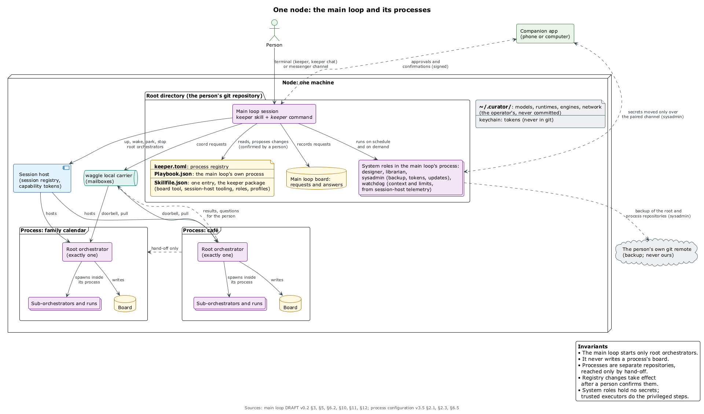

# От чат-ботов к пасеке: оркестраторы поверх любых агентских сред

<!--
Каркас дека по plan/slides-plan.ru.md: титул, открывашки семи частей, один пример рабочего слайда и финал. Слайды заполняются по плану, текст идёт из text/from-buckets-to-apiary.ru.md.

Тема — rwb-tech, пока не пришёл шаблон Подлодки; логотип RWB выключен в themeConfig, потому что доклад от Relux Works. Смена темы — одна строка theme: ../themes/rwb-minimal.
-->

---
layout: section
num: '01'
sub: 'Алексей · 8 минут · слайды 1–7'
icon: notepad
transition: slide-left
---

# Эпохи

<!--
Stack Overflow → чат и вёдра → скрипты → агенты → пробки → оркестраторы внутри вендора. На каждом слайде одно и то же: какой класс задач решали, чем и чего это стоило.
-->

---
layout: section
num: '02'
sub: 'Алексей · 17 минут · демо 1'
icon: cubes
transition: slide-left
---

# Доска и автономия

---
layout: section
num: '03'
sub: 'Алексей · 10 минут · демо 2'
icon: server
transition: slide-left
---

# Кросс-харнесс

---
layout: section
num: '04'
sub: 'Алексей · 9 минут'
icon: computer
transition: slide-left
---

# Без привязки к вендору

---
layout: section
num: '05'
sub: 'Иван · 18 минут · демо 3'
icon: cubes
transition: slide-left
---

# Пасека: процессы как конфигурация

---
layout: default
tag: '05 · ПАСЕКА'
---

# Имена: *пасека, точка, улей*

<!--
Пример рабочего слайда и проверка пути к картинкам: рендеры лежат в diagrams/ и подключаются относительным путём ../diagrams/…, без копий в slides/public. Слайд 31 плана.

Пасека — вся система. Точка — одна машина. Кипер — главный цикл машины. Улей — процесс: свой каталог, своя доска, свой корневой оркестратор. Матка — корневой оркестратор. Соты — доска. Пчела — один запуск.
-->

---
layout: section
num: '06'
sub: 'Иван · 11 минут'
icon: server
transition: slide-left
---

# Распределённая пасека и рой

---
layout: section
num: '07'
sub: 'Оба · 4 минуты'
icon: notepad
transition: slide-left
---

# Где мы

---
layout: end
who: 'Алексей Григорьев · Иван Опарин'
motif: smile
---

# Спасибо

Вопросы.

